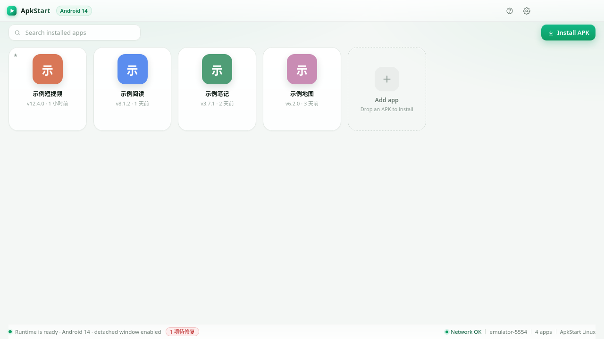
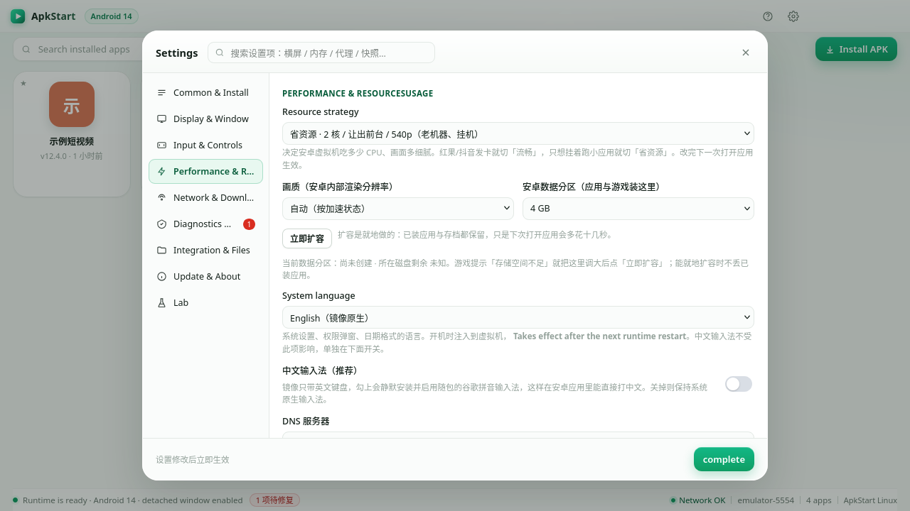

# ApkStart Linux

[](https://github.com/meshackbahati/apkstart-linux/actions/workflows/ci.yml)
[](https://github.com/meshackbahati/apkstart-linux/releases)
[](LICENSE)

Run Android apps as desktop windows on Linux. Double-click an APK to install
it, click its launcher to open it, and let the runtime go idle when no app is
active.

This is the Linux-focused fork of [RoutineMiku/apkstart](https://github.com/RoutineMiku/apkstart).
Linux packaging, the CLI, Waydroid and ATL backends, and game controls are
developed here.

<p align="center"></p>

## Quick start

Requires x86_64 Linux, a desktop session and `/dev/kvm` access for the built-in
emulator. Waydroid needs Wayland and binder instead.

```bash
# Install a release: AppImage or .deb from the releases page
chmod +x ApkStart-*-x86_64.AppImage && ./ApkStart-*-x86_64.AppImage

# Or from source
npm install && npm start

# One-time setup
bash scripts/install.sh
apkstart init --check

# Daily use
apkstart --install ~/Downloads/app.apk
apkstart com.example.app
apkstart --list
```

Enable **Associate .apk files** in settings, then double-click an APK. See
[CLI.md](docs/CLI.md) for all commands.

## What it does

- Offline APK parsing with hand-written ZIP, AXML and ARSC readers.
- `.desktop` launchers with icons extracted from the APK.
- One window per app, native keyboard and mouse input.
- Three backends, selectable with `apkstart --backend <id>`.
- Configurable DNS presets: domestic, Cloudflare, Google, or off.
- APK v2 signature verification and update-signer checks (`apkstart verify`).
- Shared folder sync between `~/ApkStartShared` and `/sdcard/ApkStartShared`.
- Hardware preflight, driver patches and periodic auto-check with one-click fixes.

| Backend | Id | Use it when |
|---|---|---|
| Built-in Android Emulator | `builtin` | X11, NVIDIA, ARM-only apps, Google Play |
| Waydroid container | `waydroid` | Wayland, native app windows, lower memory |
| Native processes | `atl` | Experimental; compatible APKs only |

Waydroid is selected automatically on Linux once installed; an explicit
backend choice always wins. Setup supports Arch, Debian/Ubuntu, Fedora,
openSUSE and Void. See [LINUX.md](docs/LINUX.md).

<p align="center"></p>

## Documentation

| Topic | File |
|---|---|
| Commands and backend setup | [CLI.md](docs/CLI.md) |
| Linux runtime and Waydroid | [LINUX.md](docs/LINUX.md) |
| Measured limits and settings | [SPECIFICATIONS.md](docs/SPECIFICATIONS.md) |
| Internals and key flows | [ARCHITECTURE.md](docs/ARCHITECTURE.md) |
| Windows-derived manual | [USER-MANUAL.md](docs/USER-MANUAL.md) |

The screenshots under `docs/screenshots/` are captured from the real renderer
with stubbed IPC data; they show interface states, not live Android sessions.
Regenerate them with `npm run docs:fixture`.

## Releasing

`.github/workflows/release.yml` runs tests, the UI fixture and CLI smoke checks,
builds an AppImage and a `.deb`, verifies `SHA256SUMS`, then publishes the
assets. Tag a version from `package.json` to trigger it:

```bash
git tag v0.6.5 && git push origin v0.6.5
```

## Development

```bash
npm test          # pure-Node suite
npm run test:boot # real QEMU boot test
npm run pack:linux
```

MIT licensed. Original project by [RoutineMiku](https://github.com/RoutineMiku/apkstart);
Linux fork at [meshackbahati/apkstart-linux](https://github.com/meshackbahati/apkstart-linux).
Runtime components are downloaded from their upstream sources under their own licences.
